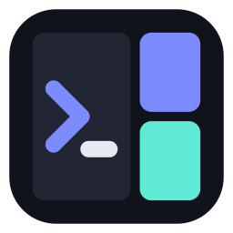

<div align="center">



# Wmux

**A Windows-native developer workspace for terminals and AI coding agents.**

Workspaces · recursive split panes · real ConPTY shells · session restore

[](https://github.com/SahinurDEV/wmux/actions/workflows/ci.yml)
[](LICENSE)


[Features](#features-today) · [Install](#install) · [Build from source](#build-from-source) · [Roadmap](docs/PROGRESS.md) · [Architecture](docs/ARCHITECTURE.md) · [Contributing](CONTRIBUTING.md)

</div>

---

> **Status: early development (v0.1, milestone 1).** Terminals, workspaces,
> splits and persistence are implemented. AI agents, the embedded browser, Git,
> port monitoring and the `wmux` CLI are on the [roadmap](docs/PROGRESS.md).

Wmux is an independent open-source project inspired by the workflow of tools
like cmux. It shares no code, branding or assets with them.

## Features (today)

- **Real terminals.** Every terminal is a Windows Pseudo Console (ConPTY)
  session rendered with xterm.js (WebGL). PowerShell 7, Windows PowerShell,
  cmd, WSL distributions, Git Bash and custom shells are detected automatically.
- **Process-tree safety.** Each shell runs in a Job Object, so closing a tab,
  killing a terminal or a Wmux crash never leaves orphaned processes.
- **Workspaces.** Create, rename, duplicate, pin, color and reorder (drag and
  drop). Each workspace has its own directory, shell, startup commands and environment.
- **Split panes.** Nested horizontal/vertical splits, resizable, maximize/
  restore, directional focus, and terminal tabs in every pane.
- **Session restore.** Workspaces, layouts, tabs and each terminal's working
  directory are saved to SQLite and restored on launch. Processes cannot
  survive a restart; restored terminals start new sessions and say so.
- **Keyboard-first.** Command palette (`Ctrl+Shift+P`) with fuzzy search and
  customizable shortcuts that never steal shell keys like `Ctrl+C/D/R/W`.
- Search in terminal output, copy/paste (Windows Terminal conventions),
  clickable links, dark/light/system themes and accent colors.

## Default shortcuts

| Action | Shortcut |
| --- | --- |
| Command palette | `Ctrl+Shift+P` |
| New workspace / open folder | `Ctrl+Shift+N` / `Ctrl+Shift+O` |
| Close workspace | `Ctrl+Shift+W` |
| Next / previous workspace | `Ctrl+Tab` / `Ctrl+Shift+Tab` |
| Switch to workspace 1-9 | `Ctrl+1` ... `Ctrl+9` |
| New terminal tab / close tab | `Ctrl+Shift+T` / `Ctrl+Shift+Q` |
| Split right / split down | `Ctrl+Shift+D` / `Ctrl+Shift+E` |
| Maximize pane | `Ctrl+Shift+Enter` |
| Focus pane in a direction | `Ctrl+Alt+Arrow` |
| Search terminal output | `Ctrl+Shift+F` |
| Restart terminal / clear | `Ctrl+Shift+R` / `Ctrl+Shift+K` |
| Toggle sidebar | `Ctrl+Shift+B` |
| Settings | `Ctrl+,` |

`Ctrl+C` copies when text is selected (otherwise it interrupts), `Ctrl+V` pastes,
and right-click copies the selection or pastes.

The original design suggested `Ctrl+D` for "split right". That is EOF in bash,
WSL, Python and many REPLs, so Wmux uses `Ctrl+Shift+D`. Every shortcut can be
changed under **Settings > Keyboard**.

## Install

Download the NSIS installer, MSI or portable ZIP from the CI artifacts or
GitHub Releases. Requirements: Windows 10 (1809+) or Windows 11 on x64, and the
Microsoft Edge WebView2 runtime (preinstalled on Windows 11; the installer
downloads it if missing). The portable ZIP needs WebView2 already installed and
stores its data in `%APPDATA%\dev.wmux.desktop` unless `WMUX_DATA_DIR` is set.

## Build from source

Prerequisites: [Rust](https://rustup.rs) (stable, MSVC toolchain), Node.js 22+,
[pnpm](https://pnpm.io) 9, and Visual Studio Build Tools with the
"Desktop development with C++" workload.

```powershell
pnpm install
pnpm dev          # run the app with hot reload
pnpm build        # NSIS + MSI installers in target/release/bundle
pnpm test         # frontend unit tests + all Rust tests
pnpm test:e2e     # end-to-end test against target/release/wmux-desktop.exe
```

### Smart App Control

Windows 11 **Smart App Control** blocks unsigned executables without
reputation, which includes every binary you compile locally (Cargo build
scripts, tests and the app itself). If a build fails with *"An Application
Control policy has blocked this file (os error 4551)"*, either turn Smart App
Control off (Windows Security > App & browser control) or build in CI. The
GitHub Actions workflow in this repository builds, tests and packages Wmux on
`windows-latest`.

## Project layout

```
apps/desktop/             React + TypeScript UI, Tauri 2 shell in src-tauri/
crates/conpty/            Safe ConPTY wrapper with Job Object process-tree control
crates/process-manager/   Terminal session threads, I/O and lifecycle
crates/session-manager/   SQLite schema, migrations, snapshots, backups
tests/e2e/                Playwright-over-CDP end-to-end test of the real app
docs/                     Architecture, decisions and progress
```

## Roadmap

| Phase | Scope | Status |
| --- | --- | --- |
| 1-3 | Foundation, ConPTY terminals, workspaces, splits, persistence | In progress |
| 4 | AI agent adapters (Claude Code, Codex, Gemini CLI, OpenCode, Aider) | Planned |
| 5 | Embedded WebView2 browser and browser automation API | Planned |
| 6 | Git panel, port monitoring, workspace search | Planned |
| 7 | `wmux` CLI and named-pipe automation API | Planned |
| 8-10 | Notifications, crash recovery, signing, auto-update, ARM64 | Planned |

Details and per-item verification status: [docs/PROGRESS.md](docs/PROGRESS.md).

## Contributing

Contributions are welcome! Please read [CONTRIBUTING.md](CONTRIBUTING.md) and
[docs/ARCHITECTURE.md](docs/ARCHITECTURE.md) first, and follow our
[Code of Conduct](CODE_OF_CONDUCT.md). Report security issues privately as
described in [SECURITY.md](SECURITY.md).

## License

[MIT](LICENSE)
